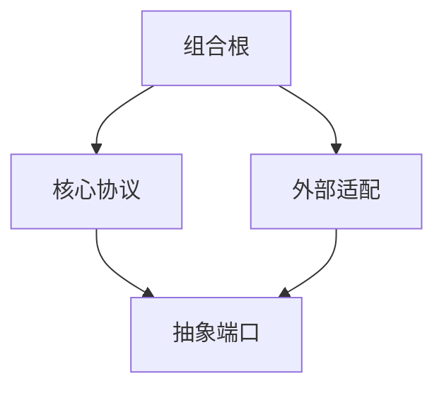

# Architecture

## Host

- **协议核心**：记录读写与确定性协作操作经统一命令行入口 `sy` 完成，协议逻辑不绑定特定会话宿主
- **容器**：使用 Herdr 承载节点进程，每个节点占一个独立窗格，user 可以直接进入对话。为避免歧义，指 Herdr 自身概念时一律带前缀写作 Herdr workspace 与 Herdr session，不带前缀的指 sayori 概念
- **布局**：Herdr workspace 按[职责树](../theory/agency/crew.md)组织，Firstmate 独占一个，每个 Task 占一个，Mate 在前，Sailor 在后，派出时不抢焦点。默认单标签页单窗格，只有 user 明确要求并排时才分屏
- **常驻**：运行中只有容器服务与各节点进程，不引入脱离会话的后台守护进程
- **工作区**：节点在所属工作区目录启动，加载该工作区的入口文档，协作记录与本地易失状态存放在该工作区的专属目录

> 例：曾因通用派活默认分屏，把下属拆进当前标签页下方，破坏了单屏只看一个 agent 的注意力边界

## Realization

同一理论概念在不同 harness 上按宿主提供的扩展能力分级落实，能用原生能力承载的不退化为输出格式技巧：

| 分级 | 宿主能力 | 落实方式 | 典型形态 |
| --- | --- | --- | --- |
| 原生扩展 | 支持扩展、钩子或界面注入，例如 Pi、DSH、Claude Code | 通过宿主原生的面板、界面挂件、状态栏、结构化工具与生命周期钩子承载协议，保持模型对话输出自然 | 会话焦点常驻界面挂件，Effect 与工作范围由只读视图分层展示 |
| 输出退化 | 接口封闭、无法注入扩展或自定义界面，例如 Codex App | 在标准行为内唯一可干预的面只有模型文本输出，通过 Skill 约束输出附带约定格式满足审阅需要 | 以红黄绿标记在输出中呈现工作范围，或通过 `show-effect` 在输出末尾列出 Effect 块 |

扩展与降级接缝划在宿主会话扩展端口。具备完整生命周期钩子的 harness 可以承载 Firstmate 与执行节点，缺少钩子的 harness 只能承担执行者，因为 Firstmate 必须能被交回与阻塞可靠唤醒

## Boundaries

协作层实现遵守严格依赖倒置，核心协议只依赖抽象端口，不直接依赖具体数据库、容器、宿主 SDK 或操作系统：

核心抽象端口划分如下：

| 端口 | 职责 |
| --- | --- |
| 持久事件存储 | 强类型只追加业务事件日志、事务提交、增量游标与变更流 |
| 本地易失状态 | 本机会话绑定、进程坐标、Station 焦点、视图偏好与互斥锁 |
| 容器运行时 | 终端快照、开闭单窗标签页、聚焦、发送输入、查询进程与配置 |
| 宿主会话扩展 | 身份注入、会话分叉与裁剪、消息投递、状态栏发布与提示 |
| 工作区环境 | 消费方工作区登记与可插拔环境观察，不在协议内写死消费方目录结构 |
| 后台进程管理 | Firstmate 长耗时命令转后台、完整环境继承与进程组回收 |
| 系统原语 | 进程存活核验、前台替换与统一互斥锁 |
| 内容目录 | 按理论与设计出处加载外部化的角色与协议说明 |

写入持久存储不得夹带容器布局等外部副作用，适配实现不得私自固化基础设施依赖导致端口无法替换

> 例：曾因写入待办事件时顺带触发容器移窗，容器超时导致任务派发报错，记录与布局状态混作一团

## Mechanism

按[派生的 Fidelity](../theory/evolution/derivation.md#fidelity)，必须在中断和疏忽下仍然成立的规则做成机制，其余外部化为带出处的内容文件：

| 形态 | 承载内容 | 变更方式 |
| --- | --- | --- |
| 机制 | 记录校验与可信信封、缺报与停下检查、委托状态机、后台进程回收、唤醒与只读投影 | 改代码，过架构与契约验证 |
| 内容 | 角色说明、派活与核对做法、交回与收口指引、焦点判断提示 | 改内容文件，核对理论与设计出处 |

- **内容独立**：角色说明与提示文本独立存放并标明出处，见[回路的 Provenance](loop.md#provenance)。机制代码不硬编码长段行为说明
- **主流程优先**：先用简洁机制把日常核心路径做稳，不为假想边缘提前堆叠防御分支。新增机制须有反复发生的 [Case](loop.md#case) 证明内容约束不住，与 [Skill 的成立条件](../theory/skill/identity.md#condition)一致
- **错误诚实**：排空、持久化与校验失败必须保留并暴露底层原因，不吞错，也不把底层故障包装成含糊的通用报错

## Testing

验证守的是架构扩展点与协议不变量，不锁死具体文案、内部步骤或临时命令拼写：

| 层级 | 守卫范围 |
| --- | --- |
| 契约层 | 用内存端口实现验证委托三事实、退站门禁、分支隔离、唤醒上限、身份唯一性与排空错误合并 |
| 边界层 | 用窄而准的真实测试验证只追加触发器、进程组回收、容器编解码与文件锁语义 |
| 入口层 | 用极简冒烟验证包加载、入口启动与静态分层边界检查 |

[Runtime](index.md)
