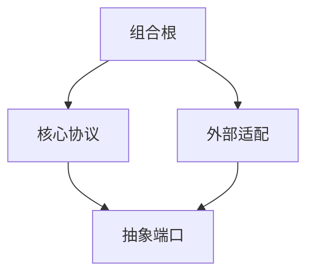

# Architecture

## Host

协作层的运行环境由协议入口、终端容器与工作区目录共同构成：

- **协议核心**：记录读写与确定性协作操作经统一命令行入口 `sy` 完成，协议逻辑独立于具体会话宿主运行
- **容器**：Herdr 承载全部节点进程，每个节点独占一个窗格以便 user 直接进入对话。涉及 Herdr 自身对象时带前缀写作 Herdr workspace 与 Herdr session，以区隔 sayori 的工作区与会话概念
- **布局**：Herdr workspace 映射[职责树](../theory/agency/crew.md)，Firstmate 独占一个，每个 Task 独占一个，Mate 排在 Sailor 之前，派出节点保持后台静默以免抢夺焦点。每个标签页默认承载单个窗格，仅在 user 显式要求并排对照时启用分屏
- **常驻**：运行态由容器服务与活跃节点进程构成，常驻进程与职责树上的活节点一一对应
- **工作区**：每个节点在所属工作区根目录启动，载入该工作区的入口文档，协作记录与本地易失状态落在该工作区的专属数据目录

> 例：派活曾沿用同窗分屏默认值把新节点拆到当前标签页下方，破坏了单屏仅看一个 agent 的注意力边界，见[单屏标签页布局偏差](../cases/single-screen-tab.md)

## Realization

同一理论概念在不同 harness 上按宿主扩展能力择优分级落实，以匹配宿主所提供的最自然交互界面：

| 分级 | 宿主能力 | 落实方式 | 典型形态 |
| --- | --- | --- | --- |
| 原生扩展 | 提供扩展接口、生命周期钩子或界面注入，例如 Pi、DSH、Claude Code | 经宿主原生的面板、界面挂件、状态栏、结构化工具与钩子承载协议，让模型对话保持自然表达 | 会话焦点常驻界面挂件，Effect 与工作范围由只读视图分层展示 |
| 输出退化 | 接口封闭，标准行为内仅可约束模型文本输出，例如 Codex App | 经 Skill 约定模型在输出中附带结构化标记以满足审阅需要 | 以红黄绿标记在输出中呈现工作范围，或在输出末尾列出结构化 Effect 块 |

扩展与降级的边界划在宿主会话扩展端口。具备完整生命周期钩子的 harness 适合承载 Firstmate 与执行节点。缺少钩子的 harness 适合承担执行节点，因为 Firstmate 需要由交回与阻塞事件可靠唤醒

## Boundaries

协作层实现遵守依赖倒置，核心协议仅依赖抽象端口，外部实现通过端口注入：

系统边界由八个抽象端口界定：

| 端口 | 职责 |
| --- | --- |
| 持久事件存储 | 强类型只追加业务事件日志、事务提交、增量游标与变更流 |
| 本地易失状态 | 本机会话绑定、进程坐标、Station 焦点、视图偏好与互斥锁 |
| 容器运行时 | 终端快照、开闭单窗标签页、聚焦、发送输入、查询进程与配置 |
| 宿主会话扩展 | 身份注入、会话分叉与裁剪、消息投递、状态栏发布与提示 |
| 工作区环境 | 工作区根目录归一化、消费方 Sailor 专业扩展与只读跨区来源声明 |
| 后台进程管理 | Firstmate 长耗时命令转后台、完整环境继承与进程组回收 |
| 系统原语 | 进程存活核验、前台替换与统一互斥锁 |
| 内容目录 | 按理论与设计出处加载外部化的角色与协议说明 |

持久事件存储端口与容器运行时端口各自独立履行职责，外部适配层从组合根接收基础设施依赖以保证端口可替换

> 例：事件提交路径曾隐式触发容器移窗并发生超时，将布局故障污染成业务派发报错，见[写入夹带容器布局超时](../cases/attention-layout-timeout.md)

## Mechanism

按[派生的 Fidelity](../theory/evolution/derivation.md#fidelity)，规则按失效代价分流到机制代码与外部化内容：

| 形态 | 承载内容 | 变更方式 |
| --- | --- | --- |
| 机制 | 记录校验与可信信封、缺报与停下检查、委托状态机、后台进程回收、唤醒与只读投影 | 修改代码，通过架构与契约验证 |
| 内容 | 角色说明、派活与核对做法、交回与收口指引、焦点判断提示 | 修改外部内容文件，核对理论与设计出处 |

- **内容独立**：角色说明与提示文本作为独立内容文件维护并标明出处，见[回路的 Provenance](loop.md#provenance)，使行为表述的迭代与机制代码解耦
- **主流程优先**：机制设计先服务日常高频核心路径，保持清晰精简。新增机制以反复出现的真实 [Case](loop.md#case) 证明内容约束不足为前提，与 [Skill 的成立条件](../theory/skill/identity.md#condition) 一致
- **错误诚实**：排空、持久化与校验阶段的失败保留并直接暴露底层原因，使故障定位准确无遮蔽

## Testing

验证体系聚焦架构扩展点与协议不变量，按耦合深度分为三层：

| 层级 | 守卫范围 |
| --- | --- |
| 契约层 | 以内存端口实现验证委托三事实、退站门禁、分支隔离、唤醒上限、身份唯一性与排空错误合并 |
| 边界层 | 以窄而准的真实测试验证只追加触发器、进程组回收、容器编解码与文件锁语义 |
| 入口层 | 以极简冒烟验证包加载、入口启动与静态分层边界检查 |

[Runtime](index.md)
