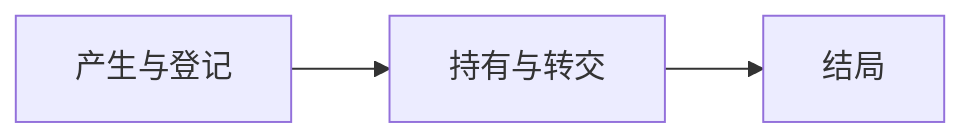

# Effect

## Premise

人类工程师起了一个测试 pod，过几天还记得把它删掉。agent 做不到：Session 会结束，上下文随之消失，留在集群里的 pod、GitHub 上的评论、数据库里的备份表却还在

这是 [Agency 领域的前提](index.md#premise)落在变化上：行动者走了，变化还在，负责的人不在场。Effect 理论只规范变化留下之后的事：**不留下没人知道、没人管的东西**。它有两条不变式：

- **有主**：每个 Effect 都按 [Ownership](../primitive/ownership.md) 有负责人、有结局。行动者的寿命比 Effect 短，所以责任必须能转交
- **一致**：user 对外部状态的认识与实际一致。环境是唯一真源，登记只是缓存，见 [Validity 的 Source](../primitive/validity.md#source)。登记、核对环境、当场报告意外，都为守住这一条

本页其余内容都从这两条推出。一个动作能不能做，见 [Approval 的 Gate](approval.md#gate)

## Scope

Effect 是为了做一件事而留在 agent 之外的变化，行动结束后它仍在，例如留下的分支与 worktree、集群里的 pod、GitHub 上的评论、数据库里的备份表。动作连带触发的变化同样算，例如推送触发的部署

拿不准时问一句：这个 Session 现在消失，这个变化会不会变成没人知道、没人管

行动按是否留下 Effect 分两种：

| Action | Meaning | Ending |
| --- | --- | --- |
| Pure | 只在自己的 Session 里，不改外部系统，例如推理、读文件、Session 内的 todo | 随 Session 消失 |
| Effectful | 在外面留下变化，这个变化就是 Effect | 按本页有结局 |

写[记录](../primitive/record.md)不是 Effect。Effect 是做事带来的变化，记录是把做事的内容留到外面，例如 Task 的当前记录、Decision Log 与登记本身。它们按 Record 维护，不登记，也不经 [Gate](approval.md#gate)。Pure 的结果要活过 Session，就写成记录

发一条评论是在做事，不是记录，仍是 Effect

## Kinds

Kind 说明一个 Effect 的寿命跟着什么走：

| Kind | Lifetime | Ending |
| --- | --- | --- |
| Intended | 跟着交付物，工作结束后仍要存在 | 交付时转交给 user |
| Byproduct | 跟着工作，为完成工作而产生 | 工作结束时收回 |

> 例：一次数据迁移，迁移本身是 Intended，迁移前做的备份表是 Byproduct。验证通过后，迁移交给 user，备份表删除

Byproduct 需要长期保留时，由 user 决定。它的寿命从此跟着交付物，按 Intended 转交

意外产生的变化没有目的，寿命无处归属，例如操作失败留下的半截状态、意料之外的连带触发。它直接破坏"一致"：agent 当场报告，按 Byproduct 登记，由 user 决定结局，并记一条 [Case](../evolution/case.md)

## Lifecycle

每一步分别见 [Register](#register)、[Hold](#hold) 与 [Ending](#ending)，[Audit](#audit) 贯穿全程

## Register

登记是 [Record](../primitive/record.md) 中的 Log：动手前写打算，完成后补结果，只追加。它记三类事件：

- **产生**：动手前写明下面各项，完成后按环境实际补上做了什么
- **转交**：负责人变更，随[交接](handoff.md)发生
- **结局**：收回并核对了环境，或转交给了 user

一条登记要能说清：

- 落在哪里：仓库、集群、数据库、表
- 实际创建、修改、停止或删除了什么
- 为什么产生它
- 依据哪一项批准，agent 自己选择的写明这一点
- Kind，以及负责人
- 什么时候、怎样结束

已经有记录说清的内容，登记只写指向，例如一条分支上的代码改动由 Git 与 PR 说清。每个 Effect 的当前状态从流水推出。登记的位置与格式属于 runtime

## Hold

Effect 在产生时就已登记，所以 Session 无论正常结束还是中断，它负责的 Effect 都能由他人接手

- **换 Session**：随[交接](handoff.md#acceptance)转给接续的 Session
- **Worker 交回 Ticket**：未结束的 Effect 逐项列出，经 [Return](handoff.md#return) 交给上层
- **负责人中断**：由职责树的上层接手，只有打算、没有结果的条目对照环境核对
- **user 查看**：各层负责的 Effect 经 [Task](../delivery/task.md#information) 汇集到[状态入口](crew.md#visibility)

## Ending

Effect 的结局就是 [Ownership 的 Ending](../primitive/ownership.md#ending)，按 Kind 落到两种情形：

- **Byproduct 收回**：按登记逐项收回，再核对环境。收回就是删除，备份与归档同样要删，换个地方留着不算收回。收回动作仍按 [Gate](approval.md#gate) 处理，它记为原 Effect 的结局，额外留下的变化才单独登记
- **Intended 转交**：经 [Acceptance](../delivery/acceptance.md) 核对后，在交付时转交给 user，登记结局

整体收口由 [Closeout](../delivery/closeout.md) 组织，结局写进它的回执

## Audit

"一致"要求 user 任何时候都能从登记得到回答：

- 外面现在有哪些 Effect，各由谁负责，什么时候结束
- 每个 Effect 是谁做的，凭什么发生

以环境为准：操作失败后，核对实际发生了什么，登记写真实状态，不写预期状态

[Agency](index.md)
