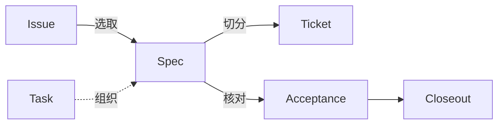

# Delivery

## Premise

本领域主要出自[前提](../premise.md)中的三个事实：user 的注意力极其有限，user 无法把预期完整表达出来，agent 会出错而且说得很有把握

预期写不全，agent 又会出错，交付与预期之间一定有差异。本领域守住的是：**这些差异，user 都看得到**。Coverage 分清每件事与 user 预期的关系，Acceptance 用环境中的证据核对，Closeout 的回执逐项列出

## Scope

本领域回答交付什么、做到什么程度算完。谁负责、能自主做到哪一步，由 [Agency](../agency/index.md) 回答。同一份要求换 agent 或换 [Mode](../agency/mode.md)，本领域的结论不变

## Definition

一项工作要定义两件事：问题是什么，怎样验证它。这两件事不看写给谁都成立，承载它们的文档按读者拆开：

- **[Issue](issue.md)**：给人看，定义问题
- **[Spec](spec.md)**：给 agent 看，从问题出发，定义怎样验证

小工作没有这两份文档时，两件事都写在 [Task](task.md#information) 的当前记录里

## Modules

| Module | Description |
| --- | --- |
| [Task](task.md) | user 持续关注的一个域怎样保持整体：记录哪些信息、谁负责、进展怎样汇报。开始关注一件新的事、接手已有工作，或 user 问"做到哪了"时读 |
| [Issue](issue.md) | 写给人看的问题：现状与预期差在哪里。写或更新 Issue，或从一个 Issue 开始工作时读 |
| [Spec](spec.md) | 把多个 Session 里已经定下的决定整理成一份交给 agent 执行的说明：写什么、怎样定测试接缝、什么时候不需要。工作跨了多个 Session、要交给其他 agent 实现，或要把讨论结果定下来时读 |
| [Coverage](coverage.md) | 一件事在不在 user 对这次结果的预期里：照做、先定下来，还是按问题处置并汇报。遇到 user 没提到的事、测出问题、发现做多了，或写交付回执时读 |
| [Ticket](ticket.md) | 把 Spec 切成垂直切片交给 Worker：怎样切、阻塞关系怎样写、什么时候要 user 确认。拆分工作、给 Worker 写任务，或接收一个 Ticket 时读 |
| [Acceptance](acceptance.md) | 怎样知道工作真的做完了，而不是看起来做完了。准备说"做完了"、写测试或验证报告、汇报结果之前读 |
| [Closeout](closeout.md) | 一件工作结束时怎样收尾：复盘、让剩余职责与 Effect 都有结局、给 user 回执。Spec 交付、Ticket 交回、PR 合并，或一个 Task 要结束时读 |

这些入口是读取路由，工作按需经过。小工作可以不写 Issue、不写 Spec、不拆 Ticket

[Theory](../index.md)
