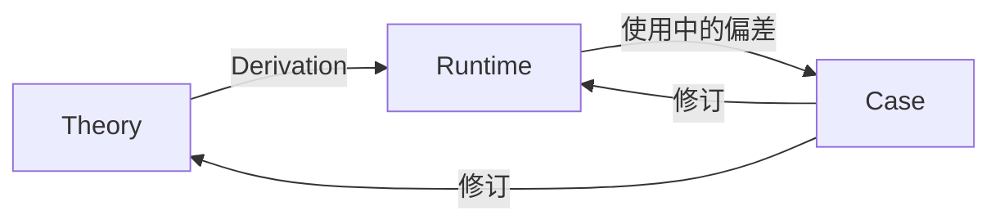

# Evolution

## Premise

进化是元层，作用于全部领域。本领域主要出自[前提](../premise.md)中的事实：agent 不会从经验中学习，同样的错误只有改变给它的东西才不再犯。其他事实决定怎样改：

- **agent 短暂**：偏差当场记下来，Session 结束就没了
- **user 的注意力极其有限**：优先处理反复消耗注意力的错误
- **agent 的上下文有限**：给 agent 的东西都占位置，不能只增不减
- **user 负责**：改不改、采不采用，由 user 决定

**user 的纠正都要落到 agent 下次得到的东西上，留下的每一条都要值得它占的位置**

## Loop

理论经[派生](derivation.md)成为 Runtime，agent 用 Runtime 工作。工作中出现偏差，记成 [Case](case.md)，据此修改理论或 Runtime，再[检验](evaluation.md)修改是否有效

派生是回路的起点。没有 Runtime 就没有使用，也就没有 Case，回路不转。user 的明确决定不需要 Case，可以直接支持修订。Case 怎样存放、由谁在什么时候整理，版本怎样依赖，都属于 runtime

## Revision

偏差可能出在几处，可以同时存在，根因需要证据支持：

- **理论**：含混、冲突或范围错误
- **派生**：理论清楚，派生漏掉条件或改变了含义
- **取得**：规则已具备，运行时没有取得或没有使用
- **环境**：只在特定环境成立，约束留在该环境

修改落在缺口所在的一处。理论修改后，检查受影响的派生。修改理论或 Runtime 按 [Approval](../agency/approval.md) 核对，采用会改变共享的运行方式，按 [Effect 的 Gate](../agency/effect.md#gate) 由 user 决定

理论页经过审阅，到 `confirmed` 为止。机制是否有效，由[检验](evaluation.md)从实际使用中得出

## Modules

| Module | Description |
| --- | --- |
| [Derivation](derivation.md) | 理论怎样变成 agent 运行时取得的说明，哪些含义不能丢。写或修改 runtime，或 runtime 出问题要追溯到理论时读 |
| [Case](case.md) | 一次偏差怎样才算记下来了：要保留什么，观察与归因怎样分开。agent 做错了、被 user 纠正，或出现意外行为时读 |
| [Evaluation](evaluation.md) | 一次修订是否真的有效、值不值得保留。修订了理论或 runtime，要决定采不采用时读 |

[Theory](../index.md)
