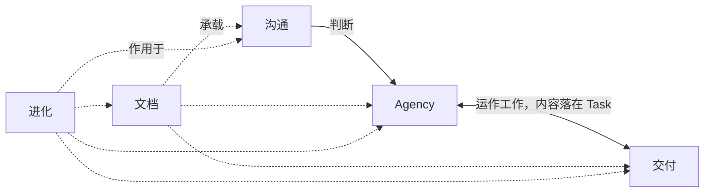

# Theory

## Principle

user 负责，注意力又极其有限，见[前提](premise.md)。user 由此定下：协作的目的，是让自己的注意力只花在[判断](primitive/judgment.md)上。理解、交付与信息维护中的同步、核对与催办，由 agent 承担。各领域据此设计

## Format

信息组织本身也是研究对象，并用于组织这套理论，见[文档](documentation/index.md)

## Modeling

先识别概念，再明确其性质与关系，据此形成理论范围与目录层级。哪些概念属于基础，由建模决定

独立对象分别建模，通过明确的关系连接，各自拥有清楚的模型。说明一条关系时，可以同时提及两端。命名方式见[书写的 Naming](documentation/writing.md#naming)

模型围绕对象、关系与依据成立。颜色、字段、文件载体与呈现方式在适用语境下表达模型

## Navigation

理论分三层：基础提供领域出发的事实与原语，协作领域各回答一个问题，进化作为元层作用于全部领域

| Layer | Module | Description |
| --- | --- | --- |
| 基础 | [前提](premise.md) | 整套理论出自哪几个事实，规则怎样从事实推出。想弄清一条规则为什么成立，或想知道一条新规则有没有根据时读 |
| 基础 | [原语](primitive/index.md) | 上层理论靠哪些基本意思说清：判断、上下文、范围、负责、记录、效力等。拿不准一个基础词的含义，或想新增、修改一个原语时读 |
| 基础 | [用词](language.md) | 怎样理解本理论里的用词，新词怎样准入。遇到不熟悉或有歧义的术语，或想新增一个概念时读 |
| 领域 | [沟通](communication/index.md) | user 和 agent 怎样使理解一致、形成决定。对话里出现误解、需要澄清或要作决定时，从这里找入口 |
| 领域 | [Agency](agency/index.md) | user 与 agent 之间谁负责、能自主做到哪一步、责任怎样转移。拿不准该不该自己做、该找谁、怎样交接时，从这里找入口 |
| 领域 | [交付](delivery/index.md) | 一项工作从问题到收尾用到的对象：Issue、Task、Spec、Ticket，以及验收与收口。组织一项新工作，或找某个交付环节时，从这里找入口 |
| 领域 | [文档](documentation/index.md) | 信息怎样组织、写给谁、怎样写。写文档、组织内容，或拿不准一份文档该怎样写时，从这里找入口 |
| 领域 | [Skill](skill/index.md) | 什么行为值得固定成 Skill，它怎样进入一次运行，怎样组合与修剪。要新建或修改 Skill，或拿不准一件事该不该做成 Skill 时，从这里找入口 |
| 元层 | [进化](evolution/index.md) | agent 不会从经验中学习，错误怎样才不再犯：反馈回路，以及它和理论、runtime 的关系。要改进理论或 runtime，或想知道一次偏差该怎样进入修订时，从这里找入口 |

- **领域关系**：沟通形成判断，Agency 依判断行动，交付组织要做的工作。Agency 与交付互相引用：工作由 Agency 的规则运作，Pending 与工作范围这些内容落在交付的对象上。文档为各领域承载信息。Skill 约束 agent 的做事过程，是进化回路改变 agent 所得内容的一种形态
- **基础**：前提与原语同级，领域从两者出发。两者都是不动点，只在有明确理由时修改并单独审阅

## Stage

理论是理解与设计依据，运行规则经[派生](evolution/derivation.md)形成。每篇在入口标明阶段，含义见[效力的 Stage](primitive/validity.md#stage)

[Repository](../index.md)
